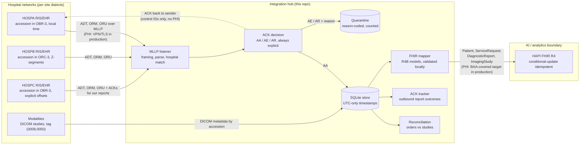

# hl7bridge

A tested HL7 v2, DICOM and FHIR integration toolkit for radiology work. It
runs an MLLP listener that gives every message one explicit ACK, reconciles
orders against imaging studies, tracks delivery of the reports you send,
reports turnaround times, lints messages against per-hospital profiles, and
syncs everything to a FHIR server. A deterministic generator makes a full
synthetic day of traffic with a labeled list of seeded defects, so every
result can be checked against known answers.

> **Synthetic data only.** Everything in this repository is made up:
> patient names come from pools like `ZZZTEST ALPHA`, MRNs look like
> `MA1001`. hl7bridge is not a certified medical device and has not had a
> security review for real patient data. Do not point it at real PHI
> without your own review. MLLP has no encryption or authentication.

## Quickstart

You need Python 3.12 or newer and Git. hl7bridge is not on PyPI yet, so
install it from a clone.

### With uv (Windows, macOS, Linux)

```
git clone https://github.com/tlo1216/hl7bridge.git
cd hl7bridge
uv sync
uv run hl7bridge --version
```

With uv, put `uv run` in front of every `hl7bridge` command below.

### Without uv, Windows PowerShell

```
git clone https://github.com/tlo1216/hl7bridge.git
cd hl7bridge
py -3.12 -m venv .venv
.venv\Scripts\Activate.ps1
python -m pip install -e .
hl7bridge --version
```

If PowerShell will not run `Activate.ps1`, skip it and call
`.venv\Scripts\hl7bridge.exe` instead of `hl7bridge`.

### Without uv, macOS or Linux

```
git clone https://github.com/tlo1216/hl7bridge.git
cd hl7bridge
python3 -m venv .venv
source .venv/bin/activate
python -m pip install -e .
hl7bridge --version
```

## Five minutes, no Docker

These commands are the same on every OS. They write to `data/quick`, which
Git ignores. Run them from the repo root.

1. Generate a synthetic day for three hospitals (139 messages, 27 DICOM
   studies, 24 outbound reports, 47 labeled defects):

   ```
   hl7bridge synth --out data/quick/synth --config config/hospitals
   ```

2. Lint the raw messages. The findings are exactly the seeded message
   defects, so the command exits with status 1 on purpose:

   ```
   hl7bridge lint --dir data/quick/synth/messages --config config/hospitals
   ```

3. Start the listener in one terminal (it binds to 127.0.0.1 only):

   ```
   hl7bridge serve --db data/quick/bridge.db --config config/hospitals
   ```

   In a second terminal, replay the day over real MLLP sockets:

   ```
   hl7bridge send --dir data/quick/synth/messages
   ```

   Stop the listener with Ctrl+C.

4. Load the DICOM metadata and the outbound report log, then read the
   reports. `--now` is the fixed report time the generator uses, so the
   output is the same every run:

   ```
   hl7bridge load-studies --db data/quick/bridge.db --config config/hospitals --dicom data/quick/synth/dicom
   hl7bridge load-outbound --db data/quick/bridge.db --path data/quick/synth/outbound_reports.jsonl
   hl7bridge summary --db data/quick/bridge.db
   hl7bridge reconcile --db data/quick/bridge.db --config config/hospitals --now 2026-10-08T12:00:00+00:00
   hl7bridge ack-report --db data/quick/bridge.db --config config/hospitals --now 2026-10-08T12:00:00+00:00
   hl7bridge tat --db data/quick/bridge.db --config config/hospitals --month 2026-10
   ```

Every command has `--help`.

## Full demo with HAPI FHIR

`scripts/demo.sh` runs all of the above plus a FHIR sync into a local HAPI
FHIR server. It needs bash (on Windows, Git Bash), Docker and uv.

```
./scripts/demo.sh
```

It prints:

1. the reconciliation report: orders without images, images without
   orders, patient and modality mismatches,
2. the report delivery report: DELIVERED, ERRORED, REJECTED and NO_ACK,
   duplicate ACKs, ACKs for unknown control IDs,
3. the quarantine summary, which is exactly the seeded defects,
4. lint findings over the raw corpus, again exactly the seeded defects,
5. the monthly turnaround-time report: median, P90 and breach counts per
   hospital, modality and priority, with missing timestamps counted,
6. FHIR sync results and the resource counts on the server.

Safety notes for the demo script:

- It publishes HAPI on `127.0.0.1:8080` only, never on other interfaces.
- Its data folder (`DATA_DIR`, default `data/demo`) is disposable and owned
  by the script. The script writes a `.hl7bridge-demo` marker file in it
  and deletes the folder on the next run only if that marker is there. It
  refuses symlinks, your home folder, the repo root and the current folder.
  If you ran an older version of the script, delete `data/demo` yourself
  once.

## Architecture: the boundaries data crosses

Most integration defects are born at boundaries, so the diagram shows those
rather than components. Solid arrows carry clinical payloads; in a real
deployment every arrow crossing the hospital boundary carries PHI and runs
over site-to-site VPN or TLS, because MLLP itself has neither encryption nor
authentication.



Where PHI does and does not go:

| Path | PHI? | Note |
| --- | --- | --- |
| Hospital to MLLP listener | Yes | VPN or TLS in any real deployment |
| Store (SQLite) and quarantine | Yes | Quarantine keeps raw bytes for diagnosis |
| ACKs back to hospitals | No | Control IDs, codes and reason text only |
| Reports on stdout | Yes | Reports are the product: they name accessions, MRNs and study UIDs |
| Log output and error text | **Never** | Store row ids, a short hash of MSH-10, hospital ids, configured message types, counts and reason codes; URL queries are stripped and HTTP client logs are held at WARNING; enforced by `tests/unit/test_phi_logging.py` |
| FHIR server | Yes | BAA-covered, access-controlled target in production |

The PHI test captures the root logger at DEBUG, so third-party loggers
count too, and checks ingest, the loaders, FHIR sync, FHIR failures (4xx
bodies that echo the identifier, 412, transport errors, timeouts),
`fhir-probe`, hostile MSH-10 and MSH-9 values, parse errors, internal
errors and the CLI's own logging setup. Error text shows file paths you
passed in, never values read from a message or a server response.

## ACK decision table

Every inbound message gets exactly one explicit decision (tested row by row
in `tests/unit/test_pipeline.py`):

| Condition | ACK | Destination |
| --- | --- | --- |
| Not valid UTF-8 / not parseable HL7 | AR | quarantine `parse_error` |
| MSH-10 control ID missing | AR | quarantine `missing_control_id` |
| MSH-4/MSH-6 match no configured hospital | AR | quarantine `unknown_hospital` |
| Type not expected for that hospital | AR | quarantine `unexpected_message_type` |
| Missing accession (per hospital config) | AE | quarantine `missing_accession` |
| Malformed timestamp | AE | quarantine `bad_timestamp` |
| Unknown OBR-25 report status | AE | quarantine `unknown_report_status` (never guessed) |
| Missing MRN / MRG / MSA, unsupported ORC-1 | AE | quarantine, reason-coded |
| Internal error (server boundary) | AR | quarantine `internal_error`, exception type and stack frames logged |
| Valid | AA | store |
| Duplicate (hospital, control ID) | AA | duplicate counter only, no reprocessing |

Bytes arriving outside MLLP framing get no ACK (nothing addressable) but are
quarantined as `mllp_junk`.

## Configuration

Each hospital is one YAML profile in `config/hospitals/`. The profile holds
everything that differs between sites, so the code never hard-codes a
field position:

```yaml
hospital_id: HOSPA
display_name: Hospital A (synthetic)
facility_codes: [HOSPA, HOSPA_RIS]   # matched against MSH-4 / MSH-6
accession_field: OBR-3               # HOSPB uses ORC-3
timezone: America/Los_Angeles        # applied to timestamps with no offset
hl7_version: "2.3"
timestamps_include_offset: false
expected_message_types: [ADT^A04, ADT^A08, ADT^A40, ORM^O01, ORU^R01]
procedure_code_system: local
reconcile:
  order_without_image_hours: 4
  order_without_image_hours_by_modality: {US: 2}
  order_lag_minutes: 60
ack_timeout_minutes: 30
tat:
  exam_to_final_target_hours: 2
  exam_to_final_target_hours_by_priority: {S: 1}
lint:
  disabled_rules: []
```

Environment variables:

| Variable | Used by | Meaning |
| --- | --- | --- |
| `HL7BRIDGE_FHIR_APIKEY` | `fhir-sync`, `fhir-probe` | Sent as an `apikey` header, for servers that expect one. Read from the environment so it never shows in process listings |
| `HL7BRIDGE_FHIR_BASE` | FHIR system tests | Base URL of a HAPI server to test against |
| `HL7BRIDGE_FHIR_REQUIRED` | FHIR system tests | `1` turns a missing server into a failure instead of a skip |

## Synthetic generator and defect manifest

`hl7bridge synth` writes `manifest.json`, naming every seeded defect and
the expected downstream outcome, computed while seeding. The system tests
assert against the manifest, so detection claims are checked against
ground truth instead of re-derived. Seeded per hospital: order without
image, image without order, patient mismatch, modality mismatch, cancelled
order (must produce zero flags), corrected report (must update, not
duplicate), missing accession, malformed timestamp, garbage bytes, AE, AR,
missing and duplicate ACKs, an ACK for a control ID never sent, and an
unmerged duplicate patient pair. Same seed, same bytes (tested). Files are
written as bytes, so HL7 segments keep their bare CR on every OS.

## Development

```
uv sync
uv run pytest -m "not fhir"
uv run ruff format --check .
uv run ruff check .
uv run mypy
uv run python tools/check_references.py
```

Without uv, `python -m pip install -e . pytest ruff mypy types-pyyaml`
gives the same tools. CI runs these on Ubuntu, Windows and macOS. The
FHIR system tests run against a HAPI container in CI; locally they skip
unless `HL7BRIDGE_FHIR_BASE` is set. What each test covers is in
[docs/testing.md](docs/testing.md), and the design rules the tests enforce
are in [docs/principles.md](docs/principles.md). Decisions are recorded in
[docs/adr/](docs/adr/).

Contributions are welcome: see [CONTRIBUTING.md](CONTRIBUTING.md). Security
reports: see [SECURITY.md](SECURITY.md). Changes: see
[CHANGELOG.md](CHANGELOG.md).

## Repository layout

```
config/hospitals/        # per-hospital dialect profiles (accession field, tz, ...)
docs/                    # principles, testing, ADRs
scripts/demo.sh          # end-to-end demo with HAPI FHIR (bash)
src/hl7bridge/
  cli.py  config.py  errors.py  hl7time.py  logsafety.py
  ingest/    # MLLP, parser, ACK, pipeline, loaders
  store/     # schema.sql, db, repo
  synth/     # generator, manifest, DICOM, patient pools
  reconcile/ # order-to-image reconciliation
  acks/      # report delivery and ACK tracking
  tat/       # turnaround-time engine and report
  lint/      # rule catalog and runner
  fhir/      # mapper, client, sync
tests/unit/  tests/system/
tools/check_references.py
```

## License

Apache License 2.0. See [LICENSE](LICENSE) and [NOTICE](NOTICE).

HL7 and FHIR are registered trademarks of Health Level Seven International.
This project is not affiliated with or endorsed by HL7.
