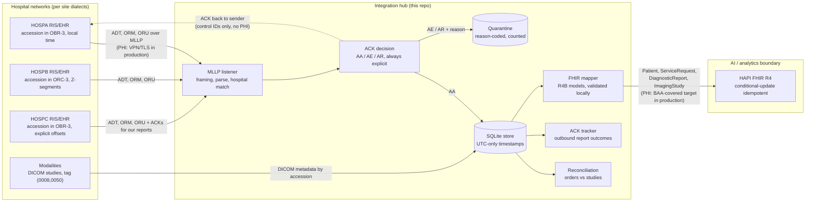

# hl7-imaging-bridge

A small, tested HL7 v2 + DICOM + FHIR pipeline for radiology integration work:
an MLLP listener with explicit ACK decisions and quarantine, order-to-image
reconciliation, report delivery (ACK) tracking, and a v2-to-FHIR bridge into
HAPI FHIR. Driven end to end by a deterministic synthetic data generator with
a labeled defect manifest.

**Synthetic data only.** No real PHI exists anywhere in this repository: not
in code, tests, fixtures, logs, or commits. Patient names come from pools
like `ZZZTEST ALPHA`, and a test fails the build if patient identifiers ever
reach log output.

## Architecture: the boundaries data crosses

Most integration defects are born at boundaries, so the diagram shows those
rather than components. Solid arrows carry clinical payloads; in a real
deployment every arrow crossing the hospital boundary carries PHI and runs
over site-to-site VPN or TLS, because MLLP itself has neither encryption nor
authentication.



Where PHI does and does not go in this design:

| Path | PHI? | Note |
| --- | --- | --- |
| Hospital to MLLP listener | Yes | VPN or TLS in any real deployment |
| Store (SQLite) and quarantine | Yes | Quarantine keeps raw bytes for diagnosis |
| ACKs back to hospitals | No | Control IDs, codes, reason text only |
| Log output | **Never** | Control IDs, hospital IDs, types, reasons; enforced by `tests/unit/test_phi_logging.py` |
| FHIR server | Yes | BAA-covered, access-controlled target in production |

## Setup

Requirements: Python 3.12+ via [uv](https://docs.astral.sh/uv/), and Docker
for the local HAPI FHIR server.

```bash
uv sync                  # creates .venv with locked dependencies
uv run pytest -m "not fhir"   # 131 tests, no external services needed
```

## Demo (one command)

```bash
./scripts/demo.sh
```

This starts HAPI FHIR (`hapiproject/hapi:v8.12.0-2`), generates one synthetic
day for three hospitals (139 messages, 27 DICOM studies, 24 outbound
reports, 47 labeled defects), replays it over real MLLP sockets, then prints:

1. the reconciliation report (orders without images, images without orders,
   patient and modality mismatches),
2. the report delivery report (DELIVERED / ERRORED / REJECTED / NO_ACK,
   duplicate ACKs, ACKs for unknown control IDs),
3. the quarantine summary (exactly the seeded defects),
4. FHIR sync results plus server-side resource counts.

Manual steps and the full CLI are in `scripts/demo.sh`; every subcommand is
`uv run hl7bridge <cmd> --help`.

## ACK decision table

Every inbound message gets exactly one explicit decision (tested row by row
in `tests/unit/test_pipeline.py`):

| Condition | ACK | Destination |
| --- | --- | --- |
| Not valid UTF-8 / not parseable HL7 | AR | quarantine `parse_error` |
| MSH-10 control ID missing | AR | quarantine `missing_control_id` |
| MSH-4/MSH-6 match no configured hospital | AR | quarantine `unknown_hospital` |
| Type not expected for that hospital | AR | quarantine `unexpected_message_type` |
| Missing accession (per hospital config) | AE | quarantine `missing_accession` |
| Malformed timestamp | AE | quarantine `bad_timestamp` |
| Unknown OBR-25 report status | AE | quarantine `unknown_report_status` (never guessed) |
| Missing MRN / MRG / MSA, unsupported ORC-1 | AE | quarantine, reason-coded |
| Internal error (server boundary) | AR | quarantine `internal_error`, stack trace logged |
| Valid | AA | store |
| Duplicate (hospital, control ID) | AA | duplicate counter only, no reprocessing |

Bytes arriving outside MLLP framing get no ACK (nothing addressable) but are
quarantined as `mllp_junk`.

## Synthetic generator and defect manifest

`hl7bridge synth` writes `manifest.json` naming every seeded defect and the
expected downstream outcome, computed while seeding. The system tests assert
against the manifest, so detection claims are ground-truthed, not
re-derived. Seeded per hospital: order without image, image without order,
patient mismatch, modality mismatch, cancelled order (must produce zero
flags), corrected report (must update, not duplicate), missing accession,
malformed timestamp, garbage bytes, AE/AR/missing/duplicate ACKs, an ACK for
a control ID never sent, and an unmerged duplicate patient pair. Same seed,
same bytes (tested).

## Tests and CI

- `tests/unit/`: 124 tests across timestamps (DST boundaries included),
  config strictness, parsing, MLLP framing, the full ACK decision table,
  store invariants, generator determinism and manifest verification,
  reconciliation (including the clean-fixture zero-flag guard), ACK
  tracking, FHIR mappers and client, and the PHI-in-logs gate.
- `tests/system/test_mllp_end_to_end.py`: generated corpus over real
  sockets, asserted against the manifest.
- `tests/system/test_fhir_hapi.py`: against live HAPI; posts everything
  twice and proves idempotency and corrected-report update-in-place.

CI (`.github/workflows/ci.yml`) fails the build on format, lint, type, or
test failure. The FHIR job runs HAPI as a service container and sets
`HL7B_FHIR_REQUIRED=1`, so a missing server fails the job rather than
skipping the tests.

## Repository layout

```
config/hospitals/        # per-hospital dialect config (accession field, tz, ...)
docs/adr/                # 0001 parser lib, 0002 storage, 0003 FHIR mapping
scripts/demo.sh          # end-to-end demo
src/hl7bridge/
  config.py  hl7time.py  errors.py  cli.py
  ingest/    # mllp, parser, ack, pipeline, loaders
  store/     # schema.sql, db, repo
  synth/     # project 9: generator, manifest, dicomgen, patients
  reconcile/ # project 2
  acks/      # project 3
  fhir/      # project 1: mapper, client, sync
tests/unit/  tests/system/
```

## Roadmap (specs in the project brief)

Built here: projects 9 (generator), 2 (reconciliation), 3 (ACK tracking),
1 (v2-to-FHIR), plus the shared ingest foundation. Specified next: 4
(turnaround-time reporting), 5 (per-hospital message linting), 6 (procedure
code normalization), 7 (report text NLP), 8 (patient merge watcher; merge
recording and the duplicate-pair seed already exist).
