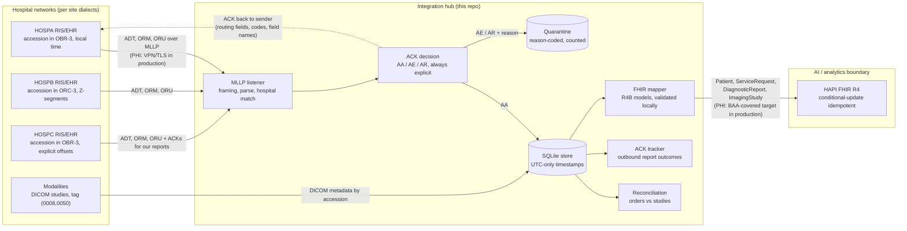

# hl7bridge

A tested HL7 v2, DICOM and FHIR integration toolkit for radiology work. It
runs an MLLP listener that gives every message one explicit ACK, reconciles
orders against imaging studies, tracks delivery of the reports you send,
reports turnaround times, lints messages against per-hospital profiles, and
syncs everything to a FHIR server. A deterministic generator makes a full
synthetic day of traffic with a labeled list of seeded defects, so every
result can be checked against known answers.

> **Synthetic data only.** Everything in this repository is made up:
> patient names come from pools like `ZZZTEST ALPHA`, MRNs look like
> `MA1001`. hl7bridge is not a certified medical device and has not had a
> security review for real patient data. Do not point it at real PHI
> without your own review. MLLP has no encryption or authentication.

## Install

You need Python 3.12 or newer and Git. hl7bridge is not on PyPI yet, so
install it from a clone. The hospital profiles and sample messages ship
inside the package, so nothing else needs to be in place.

### With uv (Windows, macOS, Linux)

```
git clone https://github.com/tlo1216/hl7bridge.git
cd hl7bridge
uv sync
uv run hl7bridge --version
```

With uv, put `uv run` in front of every `hl7bridge` command below.

### Without uv, Windows PowerShell

```
git clone https://github.com/tlo1216/hl7bridge.git
cd hl7bridge
py -3.12 -m venv .venv
.venv\Scripts\Activate.ps1
python -m pip install -e .
hl7bridge --version
```

If PowerShell will not run `Activate.ps1`, skip activation and name the
venv's own Python for the install, so the package lands in `.venv`:

```
.venv\Scripts\python.exe -m pip install -e .
.venv\Scripts\hl7bridge.exe --version
```

Then call `.venv\Scripts\hl7bridge.exe` instead of `hl7bridge`.

### Without uv, macOS or Linux

```
git clone https://github.com/tlo1216/hl7bridge.git
cd hl7bridge
python3 -m venv .venv
source .venv/bin/activate
python -m pip install -e .
hl7bridge --version
```

## Five minutes: the demo

One command runs the whole pipeline on a synthetic day for three hospitals,
in one process, on every OS:

<!-- readme-test -->
```
hl7bridge demo
```

It generates the day (139 messages, 27 DICOM studies, 24 outbound reports,
47 labeled defects), starts a listener on a free port on 127.0.0.1, replays
the day over real MLLP sockets, loads the DICOM metadata and the outbound
report log, then prints:

1. the ACK counts and the quarantine summary, which is exactly the seeded
   defects,
2. the reconciliation report: orders without images, images without
   orders, patient and modality mismatches,
3. the report delivery report: DELIVERED, ERRORED, REJECTED and NO_ACK,
   duplicate ACKs, ACKs for unknown control IDs,
4. lint findings over the raw corpus, again exactly the seeded defects,
5. the monthly turnaround-time report: median, P90 and breach counts per
   hospital, modality and priority, with missing timestamps counted,
6. a check of every count against the manifest. The demo exits 0 only when
   they all match.

The demo owns its data folder. By default it makes a fresh temporary
folder, prints its path and removes it at the end; `--keep` leaves it.
`--data-dir PATH` is accepted only for a path that does not exist yet, an
empty folder, or a folder an earlier demo marked as its own. The demo
deletes only the files it listed in its marker, never follows a link, and
refuses your home folder, the current folder, the repository root and any
folder that holds one of them. See `src/hl7bridge/demo.py`.

To include the FHIR step, name a server: `hl7bridge demo --fhir-base
http://localhost:8080/fhir`. The demo never writes into a server you did
not name and never starts Docker itself.

## Your own folder: init, doctor, lint, send

`init` copies the bundled profiles and twelve hand-made sample messages
(one per type and dialect, plus two broken ones) into `./hl7bridge`. Every
command then finds those profiles on its own:

<!-- readme-test -->
```
hl7bridge init
hl7bridge doctor
hl7bridge profile check
hl7bridge lint hl7bridge/samples
```

`doctor` checks Python, the package version, the profile folder, time
zones, the database, the listen port and the FHIR server, and says how to
fix anything that fails. `lint` exits 1 here on purpose: two samples are
broken.

Run the listener in one terminal (it binds 127.0.0.1 only):

```
hl7bridge listen
```

and send the samples from a second one:

```
hl7bridge send hl7bridge/samples
```

For each message that is not accepted, `send` shows the ACK code in words,
MSA-3, the quarantine reason and the command to run next. Stop the
listener with Ctrl+C.

## Step by step on a synthetic day

The same steps the demo runs, one command each. They write to `data/quick`
and `./hl7bridge.db`, which Git ignores. `--now` is the fixed report time
the generator uses, so the output is the same every run.

<!-- readme-test -->
```
hl7bridge synth --out data/quick/synth
hl7bridge load studies --dicom data/quick/synth/dicom
hl7bridge load outbound --path data/quick/synth/outbound_reports.jsonl
hl7bridge summary
hl7bridge reconcile --now 2026-10-08T12:00:00+00:00
hl7bridge ack-report --now 2026-10-08T12:00:00+00:00
hl7bridge tat --month 2026-10
hl7bridge tat --month 2026-10 --json
```

Every report command takes `--json`. Every command has examples in
`--help`, and `hl7bridge --help` lists them by group. The command
reference, the exit codes and the error messages are in
[docs/cli.md](docs/cli.md).

## Docker

The compose demo runs HAPI FHIR, the listener and the demo in containers,
and exits 0 when every count matches:

```
docker compose -f compose.demo.yaml up --build --exit-code-from demo
```

HAPI has no host port by default; add `-f compose.hapi-port.yaml` to browse
it at `http://127.0.0.1:8080/fhir`. The listener is published on
`127.0.0.1:2575` only. Every published port in this repository is bound to
127.0.0.1, and a check in CI (`tools/check_ports.py`) fails on any that is
not. Data lives in named volumes; `docker compose -f compose.demo.yaml down
-v` removes them.

The image alone:

```
docker build -t hl7bridge:local .
docker run --rm -p 127.0.0.1:2575:2575 hl7bridge:local
```

It runs as a non-root user, its base images are pinned by digest, and its
dependencies are installed from `uv.lock` with hashes.

### The bash demo script

`scripts/demo.sh` predates `hl7bridge demo` and does the same steps with a
HAPI container it starts itself. It needs bash (on Windows, Git Bash),
Docker and uv. It publishes HAPI on 127.0.0.1 only, stops before sending
if the MLLP port is taken or an unknown FHIR server answers, deletes its
`DATA_DIR` only when the folder holds the marker the script wrote, and on
Windows ends the listener's whole process tree when it exits.

## Architecture: the boundaries data crosses

Most integration defects are born at boundaries, so the diagram shows those
rather than components. Solid arrows carry clinical payloads; in a real
deployment every arrow crossing the hospital boundary carries PHI and runs
over site-to-site VPN or TLS, because MLLP itself has neither encryption nor
authentication.



Where PHI does and does not go:

| Path | PHI? | Note |
| --- | --- | --- |
| Hospital to MLLP listener | Yes | VPN or TLS in any real deployment |
| Store (SQLite) and quarantine | Yes | Quarantine keeps raw bytes for diagnosis |
| ACKs back to hospitals | No new PHI | The sender's own routing fields (MSH-3, MSH-4, MSH-10) echoed back, the ACK code, and MSA-3 text that is a reason code plus a field name (`bad_timestamp: PID-7`), never the rejected value |
| Reports on stdout | Yes | Reports are the product: they name accessions, MRNs and study UIDs. `send` lists message file names and the receiver's MSA-3 text here too |
| Log output and error text | **Never** | Store row ids, hospital ids, configured message types, counts and reason codes. MSH-10 is not logged, not even as a hash. HTTP client records are rebuilt from safe fields (method, URL with no query or user info, version, status); pydicom's own messages are captured and replaced; the CLI prints one sanitized line per error and no chained causes, and `--debug` adds only stack frames (code, not data). Enforced by `tests/unit/test_phi_logging.py` |
| FHIR server | Yes | BAA-covered, access-controlled target in production |

The PHI test captures the root logger at DEBUG, so third-party loggers
count too, and checks ingest, the loaders, FHIR sync, FHIR failures (4xx
bodies that echo the identifier, 412, transport errors, timeouts), a real
HTTP server whose reason phrase and `Location` header echo the identifier,
invalid DICOM values, `fhir probe`, hostile MSH-10 and MSH-9 values, parse
errors, internal errors, ACK text, a whole `demo` run at DEBUG, `send`
failures, and the CLI's own logging and error handling. Error text is checked as the full traceback. It shows paths you
passed in, never values read from a message, a DICOM file name or a server
response. User names and passwords in a `--fhir-base` URL are never
printed.

## ACK decision table

Every inbound message gets exactly one explicit decision (tested row by row
in `tests/unit/test_pipeline.py`):

| Condition | ACK | Destination |
| --- | --- | --- |
| Not valid UTF-8 / not parseable HL7 | AR | quarantine `parse_error` |
| MSH-10 control ID missing | AR | quarantine `missing_control_id` |
| MSH-4/MSH-6 match no configured hospital | AR | quarantine `unknown_hospital` |
| Type not expected for that hospital | AR | quarantine `unexpected_message_type` |
| Missing accession (per hospital config) | AE | quarantine `missing_accession` |
| Malformed timestamp | AE | quarantine `bad_timestamp` |
| Unknown OBR-25 report status | AE | quarantine `unknown_report_status` (never guessed) |
| Missing MRN / MRG / MSA, unsupported ORC-1 | AE | quarantine, reason-coded |
| Internal error (server boundary) | AR | quarantine `internal_error`, exception type and stack frames logged |
| Valid | AA | store |
| Duplicate (hospital, control ID) | AA | duplicate counter only, no reprocessing |

Bytes arriving outside MLLP framing get no ACK (nothing addressable) but are
quarantined as `mllp_junk`.

## Configuration

Each hospital is one YAML profile. The profile holds everything that
differs between sites, so the code never hard-codes a field position. The
three bundled profiles live in `src/hl7bridge/profiles/`; `hl7bridge init`
copies them for editing. Every key, its type, its default and why a site
needs it is in [docs/profiles.md](docs/profiles.md).

```yaml
hospital_id: HOSPA
display_name: Hospital A (synthetic)
facility_codes: [HOSPA, HOSPA_RIS]   # matched against MSH-4 / MSH-6
accession_field: OBR-3               # HOSPB uses ORC-3
timezone: America/Los_Angeles        # applied to timestamps with no offset
hl7_version: "2.3"
timestamps_include_offset: false
expected_message_types: [ADT^A04, ADT^A08, ADT^A40, ORM^O01, ORU^R01]
procedure_code_system: local
reconcile:
  order_without_image_hours: 4
  order_without_image_hours_by_modality: {US: 2}
  order_lag_minutes: 60
ack_timeout_minutes: 30
tat:
  exam_to_final_target_hours: 2
  exam_to_final_target_hours_by_priority: {S: 1}
lint:
  disabled_rules: []
```

Environment variables:

| Variable | Used by | Meaning |
| --- | --- | --- |
| `HL7BRIDGE_CONFIG` | every command that reads profiles | Profile folder when `--config` is not given |
| `HL7BRIDGE_DB` | every command that reads the store | Database file when `--db` is not given |
| `HL7BRIDGE_FHIR_BASE` | `fhir sync`, `fhir probe`, `doctor`, FHIR system tests | FHIR base URL when `--fhir-base` is not given |
| `HL7BRIDGE_FHIR_APIKEY` | FHIR commands | Sent as an `apikey` header, for servers that expect one |
| `HL7BRIDGE_FHIR_TOKEN` | FHIR commands | Sent as `Authorization: Bearer ...` |
| `HL7BRIDGE_FHIR_REQUIRED` | FHIR system tests | `1` turns a missing server into a failure instead of a skip |

Secrets come from the environment only, never from the command line, so
they never show in process listings. They are never printed or logged.

## Synthetic generator and defect manifest

`hl7bridge synth` writes `manifest.json`, naming every seeded defect and
the expected downstream outcome, computed while seeding. The system tests
assert against the manifest, so detection claims are checked against
ground truth instead of re-derived. Seeded per hospital: order without
image, image without order, patient mismatch, modality mismatch, cancelled
order (must produce zero flags), corrected report (must update, not
duplicate), missing accession, malformed timestamp, garbage bytes, AE, AR,
missing and duplicate ACKs, an ACK for a control ID never sent, and an
unmerged duplicate patient pair. Same seed, same bytes (tested). Files are
written as bytes, so HL7 segments keep their bare CR on every OS.


## Development

```
uv sync
uv run pytest -m "not fhir"
uv run ruff format --check .
uv run ruff check .
uv run mypy
uv run python tools/check_references.py
uv run python tools/check_licenses.py
uv run python tools/check_ports.py
```

Without uv, `python -m pip install -e . pytest ruff mypy types-pyyaml`
gives the same tools. CI runs on pushes to `main` and on pull requests,
once per change. Format, lint, type, reference, license and port checks
run on Ubuntu. The test suite runs on Ubuntu and Windows (Python 3.12 and
3.13), and on macOS too for pushes to `main` and manual runs. The wheel is
built with pinned, hashed tools and installed in a clean venv on Ubuntu
and Windows, where `init`, `doctor` and `demo` run from it. The README
commands marked for testing run as written. The Docker job builds the
image, checks it runs as non-root and runs the compose demo against HAPI.
The FHIR system tests run against a HAPI container pinned by digest;
locally they skip unless `HL7BRIDGE_FHIR_BASE` is set. What each test
covers is in [docs/testing.md](docs/testing.md), and the design rules the
tests enforce are in [docs/principles.md](docs/principles.md). Decisions
are recorded in [docs/adr/](docs/adr/).

Contributions are welcome: see [CONTRIBUTING.md](CONTRIBUTING.md). Security
reports: see [SECURITY.md](SECURITY.md). Changes: see
[CHANGELOG.md](CHANGELOG.md).

## Repository layout

```
Dockerfile  compose.demo.yaml  compose.hapi-port.yaml
docs/                    # cli, profiles, principles, testing, ADRs
scripts/demo.sh          # the bash demo with a HAPI container
src/hl7bridge/
  cli.py  config.py  errors.py  hl7time.py  logsafety.py
  demo.py    # hl7bridge demo and the one function that deletes
  doctor.py  scaffold.py (init)  jsonout.py  msgfiles.py
  profiles/  # bundled hospital profiles (in the wheel)
  samples/   # bundled sample messages (in the wheel)
  ingest/    # MLLP, parser, ACK, pipeline, loaders
  store/     # schema.sql, db, repo
  synth/     # generator, manifest, DICOM, patient pools
  reconcile/ # order-to-image reconciliation
  acks/      # report delivery and ACK tracking
  tat/       # turnaround-time engine and report
  lint/      # rule catalog and runner
  fhir/      # mapper, client, sync
tests/unit/  tests/system/
tools/       # check_references.py  check_licenses.py  check_ports.py
```

## License

Apache License 2.0. See [LICENSE](LICENSE) and [NOTICE](NOTICE).

HL7 and FHIR are registered trademarks of Health Level Seven International.
This project is not affiliated with or endorsed by HL7.
